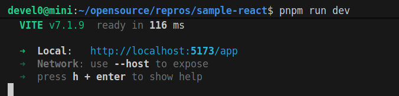
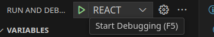
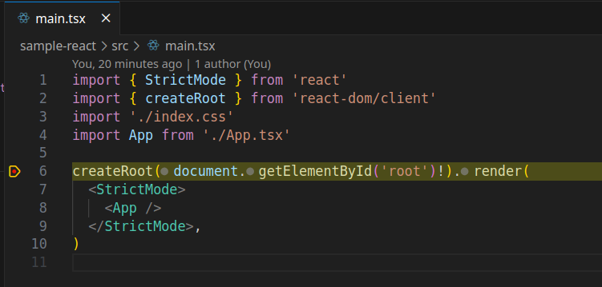
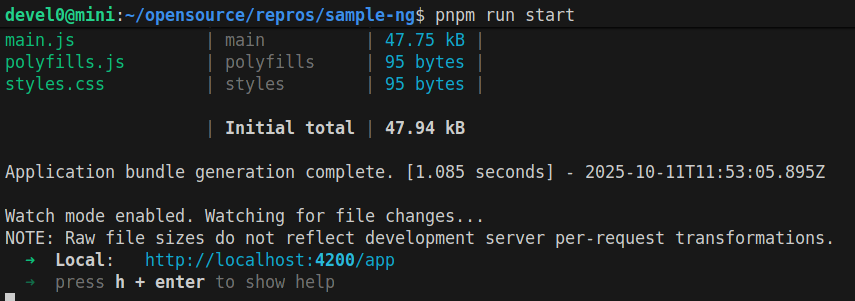
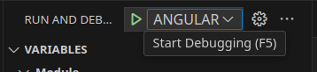
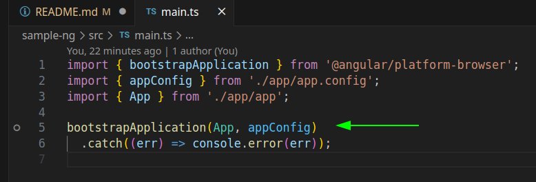
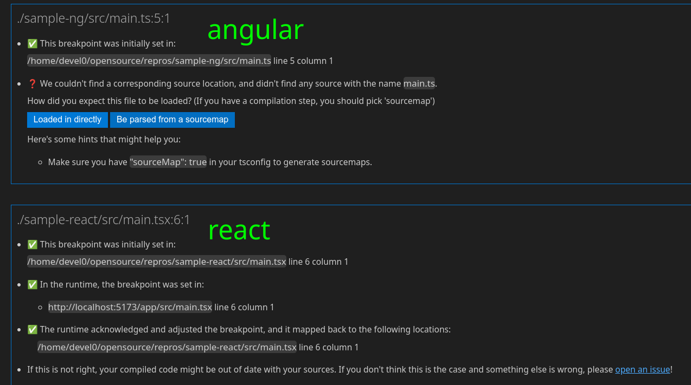

# angular cli basehref

## description

this repro want to show how breakpoint not working in angular frontend while it work with corresponding config for react+vite

## quick start

- test react

```sh
cd sample-react
code .
pnpm i
pnpm run dev
```

hit F5 to start and get breakpoint

- test angular

```sh
cd sample-ng
code .
pnpm i
pnpm run start
```

hit F5 to start and get breakpoint not working

## repro description

### case react

in the case of react start the dev



then from vscode start debug REACT



and this breakpoint can be hitted



### case angular

in the case of anguar start



then from vscode start debug ANGULAR



and this breakpoint can't be hitted



this is what vscode says about breakpoint diagnostic



## how this was built

### setup angular project

```sh
ng create sample-ng
```

### setup react project

```sh
pnpm create vite@latest sample -- --template react-ts
```

## references

- breakpoint not working [issue][2], [issue][3] 
- [source map plugin code][1]

[1]: https://github.com/angular/angular-cli/pull/15221/commits/dba606068b6c010a5a3f3a31f1e02e04474169d3
[2]: https://github.com/angular/angular-cli/issues/15211
[3]: https://github.com/angular/angular-cli/issues/15116
